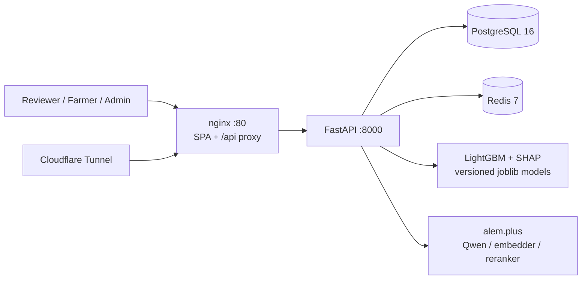
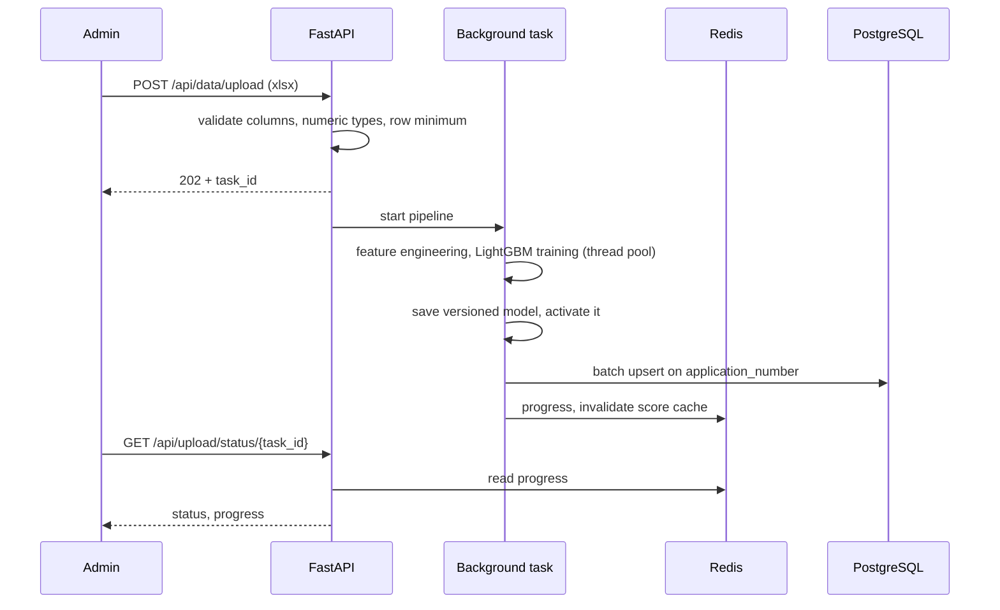

<div align="center">

<h1>k0t1k — Subsidy Scoring</h1>
<hr>

**Merit-based scoring of agricultural subsidy applications for Kazakhstan: LightGBM ranking, per-applicant SHAP explanations, human reviewers decide**


[Architecture](#architecture) · [Quick start](#quick-start) · [Docs](docs/) · English · [Русский](README.ru.md)

</div>

> [!NOTE]
> This is a government subsidy scoring system (agriculture case, Decentrathon 5.0). It is not related to the `_k0t1k` Minecraft launcher.

## What it is

Agricultural subsidies in Kazakhstan are paid in order of application submission: whoever applies first gets funded until the budget runs out. k0t1k replaces that queue with a merit score. A two-stage pipeline (hard legal filters, then a LightGBM model) ranks applications and shows the reviewer which factors drove each score. The system only recommends; the final decision stays with a human reviewer.

## Highlights

- 20-feature LightGBM model with a per-applicant SHAP explanation for every score and a weight simulation for commissions.
- FastAPI backend with 37 endpoints (REST and SSE) across three routers: public/main API, auth, admin.
- Async Excel to training pipeline: upload returns `202` with a `task_id`, training runs in the background, progress is kept in Redis, models are versioned and can be switched by an admin.
- 5-service Docker Compose stack (PostgreSQL, Redis, backend, nginx frontend, Cloudflare Tunnel); 85 backend tests.

## Role

Team lead, backend and ML, in a team of 2. **1st place at Decentrathon 5.0, GOV Case 2** (April 2026, organizer BAITC, KZT 2M team prize).

## Technical stack

| Layer | Technology |
|-------|-----------|
| Core | Python 3.12, FastAPI 0.115, Uvicorn, SQLAlchemy 2.0 (async) + asyncpg, Alembic, Pydantic 2 |
| Data | PostgreSQL 16, Redis 7 (score/explanation cache, training progress, SSE stream tickets) |
| ML | LightGBM 4.5, SHAP 0.46, scikit-learn 1.5, pandas, joblib (versioned model artifacts) |
| LLM | Qwen via alem.plus (text explanations, chat), with a SHAP-based fallback when the API is unavailable |
| Auth | JWT (python-jose), bcrypt, Google OAuth (optional), slowapi rate limits on upload and public endpoints |
| Frontend | React 19, TypeScript 5.9, Vite 8, Tailwind CSS 4, Zustand, TanStack Table, Recharts; ru/kz interface |
| Infra | Docker Compose, nginx (SPA + `/api/` proxy + SSE), Cloudflare Tunnel |

## Architecture



Training flow for an uploaded Excel file:



### Scoring and explainability

1. Hard filters reject applications that break legal rules (amount and rate bounds, pasture load per Order No. 11064).
2. The LightGBM classifier scores the rest; the target `is_merit_worthy` encodes mortality norms (Order No. 12488), amount per head and pasture compliance.
3. SHAP gives per-feature contributions for each application; Qwen turns them into text, streamed over SSE. If the LLM times out, a SHAP-based text is returned instead.
4. Weight simulation, budget simulation and FIFO-vs-merit comparison let a commission test alternative policies before deciding.

### Decisions

| Decision | Reason |
|----------|--------|
| Training in a FastAPI background task, progress in Redis | No queue infrastructure to run; the request returns immediately, the client polls `GET /api/upload/status/{task_id}` |
| One-time SSE stream tickets (60 s TTL in Redis) | The browser `EventSource` cannot send an `Authorization` header; a ticket keeps the JWT out of URLs |
| SHAP with LLM text on top, with fallback | The explanation stays correct without the LLM; the LLM only rewrites it in plain language |
| Versioned model files, activated by admin | A new training run does not replace the serving model until an admin switches to it |

## Project structure

```text
.
├── backend/
│   ├── app/api/            # endpoints, auth_router, admin_router
│   ├── app/ml/             # features, model (LightGBM), SHAP explainer
│   ├── app/services/       # scoring pipeline, PDF, proactive offers
│   ├── app/core/           # config, auth, redis, legal norms (laws.py)
│   ├── app/integrations/   # alem.plus client
│   ├── alembic/            # migrations 001-005
│   └── tests/              # 85 pytest tests
├── frontend/src/           # pages, components, i18n (ru, kz), stores
├── scripts/                # synthetic farm-feature generator
├── docs/                   # architecture, ML pipeline, API reference, deployment
└── docker-compose.yml
```

## Quick start

Requires Docker with Compose v2 and alem.plus API keys for the LLM features.

```bash
git clone https://github.com/hhhhhffd/dc-5.0-win-project.git
cd dc-5.0-win-project
cp .env.example .env   # fill in the keys
docker compose up --build -d
curl http://localhost:8000/api/health
```

The UI is at `http://localhost`, Swagger at `http://localhost:8000/docs`.

First admin: register through the UI or API, then promote the account in the `postgres` service.

```bash
curl -X POST http://localhost/api/auth/register \
  -H "Content-Type: application/json" \
  -d '{"email": "<email>", "password": "<password>", "full_name": "<name>"}'

docker compose exec postgres psql -U k0t1k -d k0t1k -c \
  "UPDATE users SET is_admin = true, is_active = true WHERE email = '<email>';"
```

> [!WARNING]
> Set `JWT_SECRET_KEY` and `POSTGRES_PASSWORD` before any non-local run. If `JWT_SECRET_KEY` is empty, a random key is generated on every start and all tokens are invalidated on restart.

Tests: `cd backend && pip install -r requirements.txt && pytest`.

<details>
<summary>Environment variables (from .env.example)</summary>

| Variable | Default | Purpose |
|----------|---------|---------|
| `POSTGRES_DB` / `POSTGRES_USER` | `k0t1k` | Database name and user |
| `POSTGRES_PASSWORD` | `k0t1k_local` | Database password |
| `REDIS_URL` | `redis://localhost:6379/0` | Overridden by compose |
| `LLM_BASE_URL` | `https://llm.alem.ai/v1` | Qwen endpoint |
| `LLM_API_KEY` | placeholder | LLM key |
| `LLM_MODEL` | `qwen3` | Model name |
| `EMBEDDER_URL` / `EMBEDDER_API_KEY` / `EMBEDDER_MODEL` | `https://llm.alem.ai/v1` / placeholder / `text-1024` | Embedder |
| `SCORE_API_URL` / `SCORE_API_KEY` | `https://reranker-llm.alem.ai/v1` / placeholder | Reranker |
| `JWT_SECRET_KEY` | placeholder | JWT signing key |
| `GOOGLE_CLIENT_ID` / `GOOGLE_CLIENT_SECRET` | empty | Optional Google OAuth |
| `CORS_ORIGINS` | `["http://localhost:80","http://localhost:5173"]` | Allowed origins |
| `CLOUDFLARE_TUNNEL_TOKEN` | placeholder | Optional tunnel |

</details>

## Limitations

- Farm-level features (pasture area, mortality, herd size) are generated synthetically from the real application export and legal norms (`scripts/generate_synthetic_features.py`). The target is derived from rules over the same inputs, so model metrics measure rule recovery and are not quoted as real-world accuracy.
- LLM text needs the alem.plus API; without it the SHAP-based fallback is used.
- Training runs in-process on one server.

More detail: [ARCHITECTURE](docs/ARCHITECTURE.md), [ML pipeline](docs/ML_PIPELINE.md), [API reference](docs/API_REFERENCE.md), [Deployment](docs/DEPLOYMENT.md), [Data sources](docs/DATA_SOURCES.md).

## License

Proprietary, all rights reserved. The source is published for viewing only. See [LICENSE](LICENSE).
