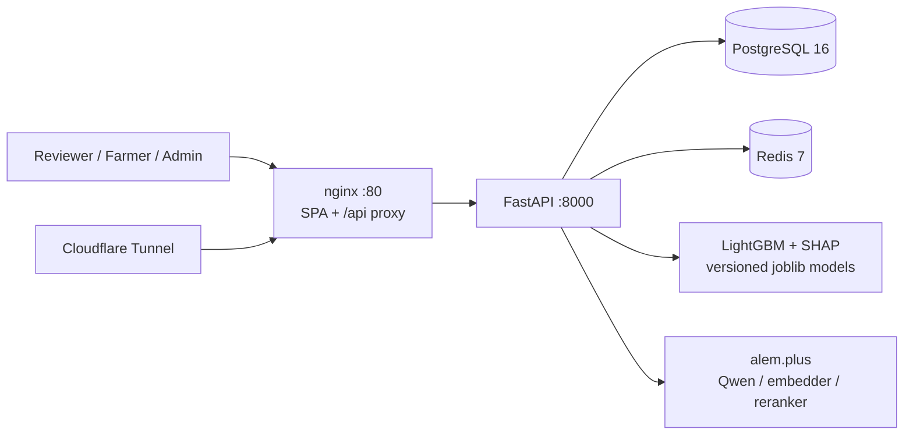
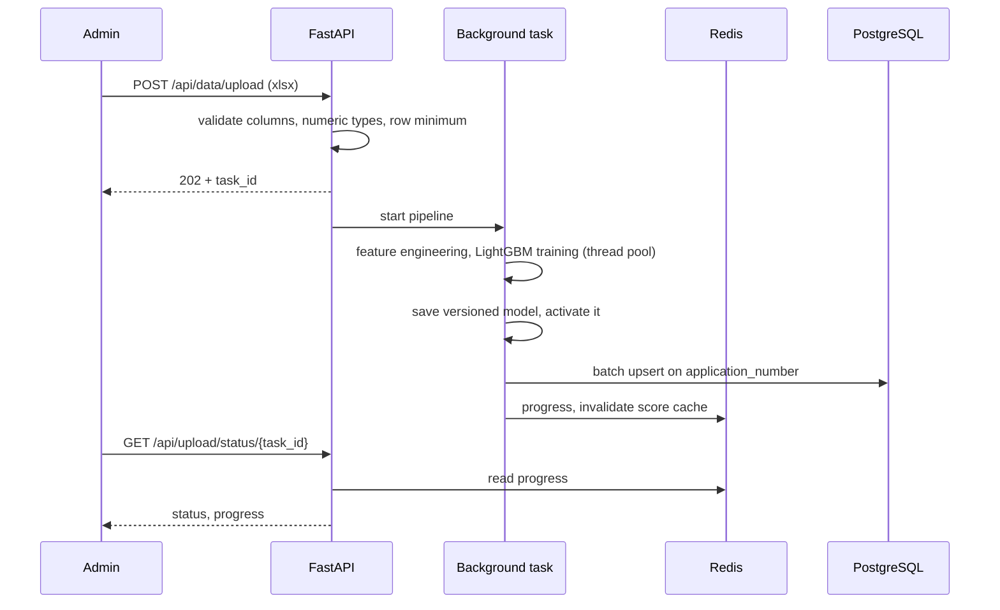

<div align="center">

<h1>k0t1k — Subsidy Scoring</h1>
<hr>

**Скоринг заявок на сельхозсубсидии в Казахстане: ранжирование LightGBM, SHAP-объяснение по каждому заявителю, финальное решение за человеком**


[Архитектура](#архитектура) · [Быстрый старт](#быстрый-старт) · [Документация](docs/) · [English](README.md) · Русский

</div>

> [!NOTE]
> Это система скоринга государственных субсидий (кейс для сельского хозяйства, Decentrathon 5.0). К Minecraft-лаунчеру `_k0t1k` отношения не имеет.

## Что это

Сельхозсубсидии в Казахстане выплачиваются по порядку подачи заявок: кто подал первым, тот и получает деньги, пока не закончится бюджет. k0t1k заменяет очередь оценкой по заслугам. Двухэтапный конвейер (жёсткие правовые фильтры, затем модель LightGBM) ранжирует заявки и показывает проверяющему, какие факторы повлияли на оценку. Система только рекомендует; финальное решение остаётся за человеком.

## Основное

- LightGBM на 20 признаках, SHAP-объяснение для каждого заявителя и симуляция весов для комиссий.
- Бэкенд на FastAPI: 37 эндпоинтов (REST и SSE) в трёх роутерах: основной/публичный API, авторизация, админка.
- Асинхронный конвейер Excel → обучение: загрузка возвращает `202` и `task_id`, обучение идёт в фоне, прогресс хранится в Redis, модели версионируются, активную модель переключает админ.
- Docker Compose из 5 сервисов (PostgreSQL, Redis, backend, nginx с фронтендом, Cloudflare Tunnel); 85 тестов бэкенда.

## Роль

Тимлид, бэкенд и ML, команда из 2 человек. **1 место на Decentrathon 5.0, GOV Case 2** (апрель 2026, организатор BAITC, командный приз 2 млн KZT).

## Технологический стек

| Слой | Технологии |
|------|-----------|
| Core | Python 3.12, FastAPI 0.115, Uvicorn, SQLAlchemy 2.0 (async) + asyncpg, Alembic, Pydantic 2 |
| Data | PostgreSQL 16, Redis 7 (кэш оценок и объяснений, прогресс обучения, тикеты SSE) |
| ML | LightGBM 4.5, SHAP 0.46, scikit-learn 1.5, pandas, joblib (версионируемые артефакты моделей) |
| LLM | Qwen через alem.plus (текстовые объяснения, чат); при недоступности API используется текст на основе SHAP |
| Auth | JWT (python-jose), bcrypt, Google OAuth (опционально), лимиты slowapi на загрузку и публичные эндпоинты |
| Frontend | React 19, TypeScript 5.9, Vite 8, Tailwind CSS 4, Zustand, TanStack Table, Recharts; интерфейс ru/kz |
| Infra | Docker Compose, nginx (SPA + прокси `/api/` + SSE), Cloudflare Tunnel |

## Архитектура



Поток обучения по загруженному Excel-файлу:



### Скоринг и объяснимость

1. Жёсткие фильтры отклоняют заявки, нарушающие правовые нормы (границы суммы и норматива, пастбищная нагрузка по приказу № 11064).
2. Классификатор LightGBM оценивает остальные; целевая переменная `is_merit_worthy` кодирует нормы падежа (приказ № 12488), сумму на голову и соблюдение пастбищных норм.
3. SHAP даёт вклад каждого признака по каждой заявке; Qwen превращает его в текст, который стримится по SSE. Если LLM не отвечает по таймауту, возвращается текст на основе SHAP.
4. Симуляция весов, симуляция бюджета и сравнение FIFO и merit позволяют комиссии проверить альтернативные политики до принятия решения.

### Решения

| Решение | Причина |
|---------|---------|
| Обучение в фоновой задаче FastAPI, прогресс в Redis | Не нужна инфраструктура очередей; запрос возвращается сразу, клиент опрашивает `GET /api/upload/status/{task_id}` |
| Одноразовые тикеты SSE (TTL 60 с в Redis) | `EventSource` в браузере не умеет отправлять заголовок `Authorization`; тикет не пускает JWT в URL |
| SHAP как основа, текст LLM сверху, с запасным вариантом | Объяснение остаётся верным без LLM; LLM лишь пересказывает его простым языком |
| Версионируемые файлы моделей, активация админом | Новое обучение не подменяет рабочую модель, пока админ не переключит её |

## Структура проекта

```text
.
├── backend/
│   ├── app/api/            # endpoints, auth_router, admin_router
│   ├── app/ml/             # признаки, модель (LightGBM), SHAP-объяснитель
│   ├── app/services/       # конвейер скоринга, PDF, проактивные предложения
│   ├── app/core/           # конфиг, auth, redis, правовые нормы (laws.py)
│   ├── app/integrations/   # клиент alem.plus
│   ├── alembic/            # миграции 001-005
│   └── tests/              # 85 тестов pytest
├── frontend/src/           # страницы, компоненты, i18n (ru, kz), сторы
├── scripts/                # генератор синтетических признаков ферм
├── docs/                   # архитектура, ML-конвейер, справочник API, деплой
└── docker-compose.yml
```

## Быстрый старт

Нужны Docker с Compose v2 и ключи alem.plus для LLM-функций.

```bash
git clone https://github.com/hhhhhffd/dc-5.0-win-project.git
cd dc-5.0-win-project
cp .env.example .env   # впишите ключи
docker compose up --build -d
curl http://localhost:8000/api/health
```

Интерфейс: `http://localhost`, Swagger: `http://localhost:8000/docs`.

Первый администратор: зарегистрируйтесь через UI или API, затем повысьте аккаунт в сервисе `postgres`.

```bash
curl -X POST http://localhost/api/auth/register \
  -H "Content-Type: application/json" \
  -d '{"email": "<email>", "password": "<password>", "full_name": "<name>"}'

docker compose exec postgres psql -U k0t1k -d k0t1k -c \
  "UPDATE users SET is_admin = true, is_active = true WHERE email = '<email>';"
```

> [!WARNING]
> Перед любым нелокальным запуском задайте `JWT_SECRET_KEY` и `POSTGRES_PASSWORD`. Если `JWT_SECRET_KEY` пуст, при каждом старте генерируется случайный ключ и все токены перестают действовать после перезапуска.

Тесты: `cd backend && pip install -r requirements.txt && pytest`.

<details>
<summary>Переменные окружения (из .env.example)</summary>

| Переменная | Значение по умолчанию | Назначение |
|------------|----------------------|-----------|
| `POSTGRES_DB` / `POSTGRES_USER` | `k0t1k` | Имя БД и пользователь |
| `POSTGRES_PASSWORD` | `k0t1k_local` | Пароль БД |
| `REDIS_URL` | `redis://localhost:6379/0` | Переопределяется в compose |
| `LLM_BASE_URL` | `https://llm.alem.ai/v1` | Эндпоинт Qwen |
| `LLM_API_KEY` | заглушка | Ключ LLM |
| `LLM_MODEL` | `qwen3` | Имя модели |
| `EMBEDDER_URL` / `EMBEDDER_API_KEY` / `EMBEDDER_MODEL` | `https://llm.alem.ai/v1` / заглушка / `text-1024` | Эмбеддер |
| `SCORE_API_URL` / `SCORE_API_KEY` | `https://reranker-llm.alem.ai/v1` / заглушка | Реранкер |
| `JWT_SECRET_KEY` | заглушка | Ключ подписи JWT |
| `GOOGLE_CLIENT_ID` / `GOOGLE_CLIENT_SECRET` | пусто | Опциональный Google OAuth |
| `CORS_ORIGINS` | `["http://localhost:80","http://localhost:5173"]` | Разрешённые origin |
| `CLOUDFLARE_TUNNEL_TOKEN` | заглушка | Опциональный туннель |

</details>

## Ограничения

- Признаки уровня хозяйства (площадь пастбищ, падёж, поголовье) генерируются синтетически по реальной выгрузке заявок и правовым нормам (`scripts/generate_synthetic_features.py`). Целевая переменная выводится правилами из тех же входных данных, поэтому метрики модели отражают восстановление правил и не приводятся как точность в реальных условиях.
- Текстовые объяснения LLM требуют API alem.plus; без него используется текст на основе SHAP.
- Обучение выполняется внутри процесса на одном сервере.

Подробнее: [ARCHITECTURE](docs/ARCHITECTURE.md), [ML-конвейер](docs/ML_PIPELINE.ru.md), [справочник API](docs/API_REFERENCE.ru.md), [деплой](docs/DEPLOYMENT.ru.md), [источники данных](docs/DATA_SOURCES.md).

## Лицензия

Проприетарная, все права защищены. Исходный код опубликован только для просмотра. См. [LICENSE](LICENSE).
